# LitroPH: Fuel-Efficient Route Optimization Dashboard

LitroPH is an end-to-end data engineering project that helps Filipino motorists find the cheapest route, not just the fastest one. It scrapes weekly Philippine pump prices, models them in a PostgreSQL warehouse with dbt, and uses them to price every driving route that the TomTom Routing API suggests, with live traffic taken into account.

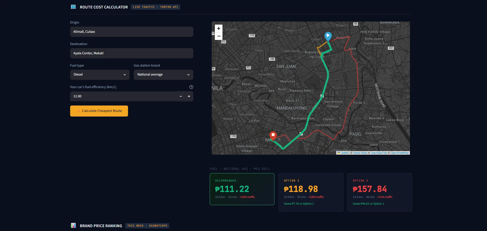

## Contents

- [Problem statement](#problem-statement)
- [Objectives](#objectives)
- [Features](#features)
- [Fuel cost model](#fuel-cost-model)
- [System architecture](#system-architecture)
- [Technology stack](#technology-stack)
- [Repository structure](#repository-structure)
- [Data model](#data-model)
- [Reproduce the project](#reproduce-the-project)
- [Automate and host for free](#automate-and-host-for-free)
- [Deploy on AWS](#deploy-on-aws)
- [AWS implementation](#aws-implementation)
- [Engineering challenges](#engineering-challenges)
- [Troubleshooting](#troubleshooting)
- [Scope, limitations and future work](#scope-limitations-and-future-work)
- [References](#references)

---

## Problem statement

Fuel prices in the Philippines are adjusted every week and differ by brand. Navigation apps such as Google Maps and Waze optimize for travel time or distance, but none of them tells a driver what a trip will actually cost in fuel. A shorter route through heavy traffic can burn more fuel than a longer route that keeps moving.

Drivers face four problems at once:

- Weekly fuel prices keep changing.
- Traffic congestion significantly increases fuel consumption.
- Gas station brands charge different pump prices.
- No routing tool combines fuel prices with route information.

LitroPH combines automated weekly price collection, a cloud data warehouse and live routing into one application that estimates the real peso cost of every route option.

## Objectives

- Automate the weekly extraction of brand-level fuel prices from [GasWatch PH](https://gaswatchph.com/).
- Preserve every raw extraction as an immutable JSON archive.
- Load structured records into a normalized PostgreSQL warehouse with idempotent, transactional writes.
- Transform and test the data with dbt Core before the dashboard reads it.
- Estimate route fuel cost from live traffic, current prices and the user's vehicle efficiency.
- Deploy the full system on AWS, with a zero-cost alternative that runs the same code.

## Features

- Weekly scraping of 7 fuel types across 11 brands, scheduled and fully automated
- Raw JSON archive (bronze layer) plus a dimensional PostgreSQL warehouse
- dbt staging and mart models with 14 data tests
- Route cost calculator: up to three live-traffic routes, ranked by fuel cost, drawn on an interactive map
- Brand-specific or national-average pricing
- Weekly price ticker, brand price ranking, and price trend history with a fuel-type filter
- Responsive dark-themed dashboard for desktop and mobile

## Fuel cost model

$$\text{Cost}_{\text{route}} = \frac{D}{E \times M} \times P \qquad\qquad M = \min\left(\frac{T_{\text{free-flow}}}{T_{\text{live}}},\ 1\right)$$

| Symbol | Meaning | Source |
|---|---|---|
| D | Route distance (km) | TomTom Routing API |
| E | Vehicle fuel efficiency (km/L) | Entered by the user (default 12) |
| M | Traffic multiplier. 1.0 is free-flowing traffic; lower values model the efficiency lost to stop-and-go driving. Capped at 1. | TomTom free-flow vs. live travel time |
| P | Price per liter (₱) | `analytical_core.brand_prices_weekly`: the chosen brand, or the national average |

The base relationship (fuel used = distance ÷ efficiency; cost = fuel used × price) follows standard fuel economy principles from the US EPA and Department of Energy. The traffic multiplier is this project's addition.

**Example:** a 17.2 km trip in a 12 km/L car with M = 0.80 and Diesel at ₱93.85/L costs 17.2 ÷ (12 × 0.80) × 93.85 = **₱168.15**.

---

## System architecture

LitroPH follows the **medallion architecture**. Each layer has one job, and the dashboard only reads the gold layer.

| Layer | Objects | Purpose |
|---|---|---|
| **Bronze** | Raw JSON archive; `raw_ingestion.dim_brands`, `raw_ingestion.fact_brand_prices` | Immutable record of every extraction. Prices are still strings such as `₱93.85`. |
| **Silver** | `analytical_core.stg_fuel_prices` (view) | Strips the peso sign, casts to `NUMERIC(8,2)`, types every column, resolves brand names. |
| **Gold** | `analytical_core.fuel_prices_weekly`, `analytical_core.brand_prices_weekly` (tables) | Consumer-facing marts for the ticker, charts and route calculator. |

The same code deploys two ways.

**AWS deployment**

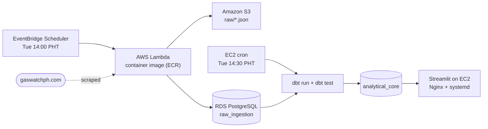

**Free-tier deployment**

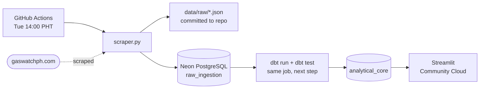

| Concern | AWS | Free tier |
|---|---|---|
| Weekly trigger | EventBridge Scheduler, `cron(0 14 ? * TUE *)` Asia/Manila | GitHub Actions, `0 6 * * 2` UTC (same time) |
| Scraper runtime | Lambda, container image in ECR | GitHub-hosted Ubuntu runner |
| Entry point | `scraper.lambda_handler` | `python scraper.py` |
| Raw archive | S3 `raw/fuel_prices_YYYY-MM-DD.json` | `data/raw/fuel_prices_YYYY-MM-DD.json` |
| Warehouse | RDS PostgreSQL 18 | Neon serverless PostgreSQL 18 |
| dbt run + test | EC2 cron (`run_pipeline.sh`) | Same workflow job, after the load |
| Dashboard | EC2 · Nginx → Streamlit · systemd | Streamlit Community Cloud |

## Technology stack

| Area | Tools |
|---|---|
| Languages | Python 3.12, SQL |
| Scraping | Playwright (headless Chromium), BeautifulSoup |
| Warehouse | PostgreSQL 18, psycopg2 |
| Transformation | dbt Core with the dbt-postgres 1.10 adapter |
| Dashboard | Streamlit, Plotly, Folium, pandas |
| Maps and routing | TomTom Routing and Search APIs, Stadia Maps tiles |
| AWS | Lambda, ECR, EventBridge Scheduler, S3, RDS, EC2, Elastic IP, IAM, Security Groups, CloudWatch |
| Free tier | GitHub Actions, Neon, Streamlit Community Cloud |
| Operations | Docker, Ubuntu, systemd, Nginx, Certbot, cron, Git |

## Repository structure

```text
├── .github/workflows/
│   └── weekly_pipeline.yml   weekly scrape → load → dbt run/test (free tier)
├── app.py                    Streamlit dashboard and route cost engine
├── scraper.py                scrape → QA gate → archive → load; main() and lambda_handler()
├── scripts/init_db.py        creates the warehouse schemas and raw tables
├── sql/create_raw_tables.sql DDL for raw_ingestion
├── transformation/           dbt project "litroph_transformation"
│   ├── dbt_project.yml
│   ├── profiles.yml          connection read from DB_* environment variables
│   └── models/
│       ├── staging/          stg_fuel_prices.sql, schema.yml
│       └── marts/            fuel_prices_weekly.sql, brand_prices_weekly.sql, schema.yml
├── Dockerfile                Lambda container image (AWS)
├── run_pipeline.sh           EC2 cron job: dbt run + dbt test (AWS)
├── deploy/aws/               systemd unit and Nginx config for EC2
├── data/raw/                 bronze JSON archive, one file per weekly run
├── docs/screenshots/         AWS deployment screenshots
├── Notebooks/                Phase 1 prototypes: extraction, TomTom routing, cost model, dashboard
├── requirements.txt          dashboard dependencies
├── requirements-pipeline.txt scraper and dbt dependencies
└── .env.example              template for all configuration
```

## Data model

**`raw_ingestion.dim_brands`**: `brand_id` (PK), `brand_name` (unique), `created_at`.

**`raw_ingestion.fact_brand_prices`**: one row per brand, fuel type and week.

| Column | Example | Notes |
|---|---|---|
| `price_id` | 1 | Primary key |
| `ingestion_run_id` | UUID | Shared by every row of one scraper run |
| `brand_id` | 3 | Foreign key → `dim_brands` |
| `fuel_display_name` | Prem Diesel | As published |
| `fuel_type_slug` | prem-diesel | Lowercase, hyphenated |
| `current_price` | ₱100.67 | Raw string in bronze |
| `price_unit` | PHP_per_liter | |
| `price_trend` | UP | `UP`, `DOWN` or `STABLE` |
| `weekly_change` | ₱2.60 | Absolute value; direction lives in `price_trend` |
| `week_date` | 2026-10-20 | From the site's "Week of" banner |
| `extraction_timestamp` | 2026-10-23 17:11:00 | Asia/Manila |
| `source` | gaswatchph.com | |

`uq_price_per_week` is unique on (`week_date`, `brand_id`, `fuel_type_slug`), which makes every load idempotent: re-running a week inserts nothing.

**dbt models** (schema `analytical_core`):

| Model | Type | Contents |
|---|---|---|
| `stg_fuel_prices` | view | Typed, cleaned prices joined to brand names |
| `fuel_prices_weekly` | table | Per week and fuel type: `price_min`, `price_max`, `price_avg`, `brand_count` |
| `brand_prices_weekly` | table | Per week, brand and fuel type: `price_php`, `price_trend`, `weekly_change_php` |

**dbt tests (14):** `not_null` on the key columns of all three models, plus `accepted_values` that restricts `fuel_type_slug` to diesel, prem-diesel, unleaded-91, prem-95, prem-97, e-gas and kerosene. A new fuel type on the source site fails this test on purpose so it gets reviewed.

---

## Reproduce the project

These steps build the whole project on your own machine, from an empty database to a running dashboard. Commands are shown for Windows PowerShell, with macOS/Linux equivalents where they differ.

### Prerequisites

- [Python 3.12](https://www.python.org/downloads/) (the version the pinned requirements are tested with; on Windows, tick **Add python.exe to PATH**)
- [Git](https://git-scm.com/)
- [VS Code](https://code.visualstudio.com/) with the Python and Jupyter extensions (optional, for editing and the notebooks)
- A PostgreSQL database. Either:
  - **Local:** [Docker Desktop](https://www.docker.com/products/docker-desktop/), used in step 3, or
  - **Hosted:** a free [Neon](https://neon.tech/) project, or an AWS RDS instance
- A free [TomTom Developer](https://developer.tomtom.com/) API key (routing and geocoding)
- A free [Stadia Maps](https://client.stadiamaps.com/signup/) API key (map tiles)

### 1. Clone and install

```powershell
git clone https://github.com/james-kalaw/litroph.git
cd litroph
py -3.12 -m venv .venv                # macOS/Linux: python3.12 -m venv .venv
Set-ExecutionPolicy RemoteSigned -Scope CurrentUser   # Windows, once per machine: allows Activate.ps1 to run
.\.venv\Scripts\Activate.ps1          # macOS/Linux: source .venv/bin/activate
pip install -r requirements.txt -r requirements-pipeline.txt
python -m playwright install chromium
```

### 2. Configure

Copy the template and fill in your values:

```powershell
Copy-Item .env.example .env           # macOS/Linux: cp .env.example .env
```

| Variable | Used by | Value |
|---|---|---|
| `DB_HOST`, `DB_PORT`, `DB_NAME`, `DB_USER`, `DB_PASSWORD` | scraper, dbt, app | Your PostgreSQL connection |
| `DB_SSLMODE` | scraper, dbt, app | `disable` for local Docker, `require` for Neon or RDS |
| `TOMTOM_API_KEY` | app | TomTom key |
| `STADIA_API_KEY` | app | Stadia Maps key |
| `S3_BUCKET` | scraper (Lambda only) | S3 bucket for the raw archive |

`.env` is git-ignored. Never commit it.

### 3. Start a database (local option)

```powershell
docker run -d --name litroph-db -e POSTGRES_PASSWORD=litroph -e POSTGRES_DB=litroph_db -p 5432:5432 postgres:18
```

Matching `.env` values: `DB_HOST=localhost`, `DB_PORT=5432`, `DB_NAME=litroph_db`, `DB_USER=postgres`, `DB_PASSWORD=litroph`, `DB_SSLMODE=disable`.

### 4. Create the schemas and raw tables

```powershell
python scripts/init_db.py
```

Expected output: `Ready: raw_ingestion.dim_brands, raw_ingestion.fact_brand_prices`. The script is safe to run again.

### 5. Scrape this week's prices

```powershell
python scraper.py --dry-run           # optional: scrape and save JSON only, no database writes
python scraper.py                     # scrape, archive to data/raw/, load into PostgreSQL
```

Expected output ends with `QA Passed. Successfully extracted 54 structured records.` and `Relational ingestion complete.` Running it again in the same week loads `0 new` rows; that is the idempotency constraint working.

### 6. Build and test the warehouse models with dbt

dbt reads its connection from environment variables, not from `.env`, so load `.env` into the terminal session first:

```powershell
# Windows PowerShell
Get-Content .env | Where-Object { $_ -match '^\s*([A-Z_]+)\s*=\s*(.*)$' } | ForEach-Object { Set-Item "env:$($Matches[1])" $Matches[2].Trim('"') }
```

```bash
# macOS/Linux
set -a; source .env; set +a
```

Then:

```powershell
cd transformation
dbt run --profiles-dir .
dbt test --profiles-dir .
cd ..
```

Expected: `PASS=3` for `dbt run` (one view, two tables) and `PASS=14` for `dbt test`.

### 7. Run the dashboard

```powershell
streamlit run app.py
```

Open http://localhost:8501, enter an origin and destination in Metro Manila (for example "SM North EDSA" and "Ayala Center, Makati"), and select **Calculate Cheapest Route**.

### Moving to a new machine

The repository holds all code, SQL, dbt models, deployment files and the raw JSON archive. A few things are deliberately **not** in Git, so carry them over separately (a password manager works well for the first two):

| Item | Why it's not in Git | What to do |
|---|---|---|
| `.env` | Holds passwords and API keys | Copy it across, or rebuild it from `.env.example` and your Neon / TomTom / Stadia dashboards |
| EC2 key pair (`.pem`) | Grants server access | Only needed for the AWS deployment; AWS never lets you download it again |
| `backups/*.dump` | Full database dumps | The live data stays in your hosted database; keep a recent dump somewhere safe |

Then follow steps 1–7 above. With a hosted database (Neon or RDS) you can skip steps 3 and 4, because the tables and full history are already there.

### Explore the Phase 1 notebooks (optional)

The `Notebooks/` folder holds the original prototypes that proved the logic before the pipeline existed: `02` extraction from GasWatch PH, `03` TomTom routing, `04` the cost model and `05` the dashboard prototype. Select the `.venv` kernel in VS Code to run them.

---

## Automate and host for free

This runs the weekly pipeline and the public dashboard at no cost, with no personal machine involved.

### 1. Database on Neon

1. Create a project at [neon.tech](https://neon.tech/) (PostgreSQL 18, a region near your users) with a database named `litroph_db`.
2. Put its host, user and password in `.env` with `DB_SSLMODE=require`, then run `python scripts/init_db.py`.
3. Optional: load existing history from another PostgreSQL database with `pg_dump` / `pg_restore`:
   ```powershell
   docker run --rm -e PGPASSWORD=<source-password> -v "${PWD}\backups:/backups" postgres:18 pg_dump -h <source-host> -U <user> -d litroph_db --no-owner --no-privileges -Fc -f /backups/litroph.dump
   docker run --rm -e PGPASSWORD=<neon-password> -v "${PWD}\backups:/backups" postgres:18 pg_restore -h <neon-host> -U <neon-user> -d litroph_db --no-owner --no-privileges /backups/litroph.dump
   ```

### 2. Weekly pipeline on GitHub Actions

`.github/workflows/weekly_pipeline.yml` runs every Tuesday at 14:00 Philippine time. It installs dependencies, runs `python scraper.py`, runs `dbt run` and `dbt test`, and commits the new raw JSON to `data/raw/`.

1. In the GitHub repository, open **Settings → Secrets and variables → Actions** and add the repository secrets `DB_HOST`, `DB_PORT`, `DB_NAME`, `DB_USER` and `DB_PASSWORD`.
2. Open **Actions → Weekly fuel price pipeline → Run workflow** to test it once by hand.

### 3. Dashboard on Streamlit Community Cloud

1. At [share.streamlit.io](https://share.streamlit.io/), create an app from this repository, branch `main`, main file `app.py`, Python 3.12.
2. Under **Advanced settings → Secrets**, paste:
   ```toml
   DB_HOST = "<neon-host>"
   DB_PORT = "5432"
   DB_NAME = "litroph_db"
   DB_USER = "<neon-user>"
   DB_PASSWORD = "<neon-password>"
   DB_SSLMODE = "require"
   TOMTOM_API_KEY = "<tomtom-key>"
   STADIA_API_KEY = "<stadia-key>"
   ```
3. Deploy. Every push to `main` redeploys the app automatically.

Free-tier behavior: Streamlit apps sleep after a period without visitors and wake in about 30 seconds; Neon suspends idle compute and wakes in about a second. The app reconnects automatically when that happens.

---

## Deploy on AWS

This is the full AWS architecture. All resources live in one region (the project uses `us-east-1`). You need the [AWS CLI](https://aws.amazon.com/cli/) configured with an IAM user that can manage these services, and Docker Desktop.

### 1. S3 data lake

Create a bucket (for example `litroph-data-lake-<you>`). The scraper writes to `raw/fuel_prices_YYYY-MM-DD.json`.

### 2. RDS PostgreSQL warehouse

1. Create a PostgreSQL 18 instance (`db.t4g.micro` is enough) with a database named `litroph_db`.
2. In its security group, allow inbound PostgreSQL (5432) only from the addresses that need it: your own IP (`/32`) for setup and the EC2 instance's security group.
3. Point `.env` at the RDS endpoint with `DB_SSLMODE=require` and run `python scripts/init_db.py`.

### 3. IAM execution role for Lambda

Create a role for Lambda (for example `LitroPH-LambdaExecutionRole`) with:
- the AWS-managed policy `AWSLambdaBasicExecutionRole` (CloudWatch Logs), and
- a customer-managed policy that allows writing only to the archive prefix:
  ```json
  {
    "Version": "2012-10-17",
    "Statement": [
      { "Effect": "Allow", "Action": "s3:PutObject", "Resource": "arn:aws:s3:::<your-bucket>/raw/*" }
    ]
  }
  ```

### 4. Build and push the scraper image to ECR

Playwright's Chromium is too large for a Lambda ZIP package, so the scraper ships as a container image.

```powershell
aws ecr create-repository --repository-name litroph-scraper-repo --region us-east-1
aws ecr get-login-password --region us-east-1 | docker login --username AWS --password-stdin <account-id>.dkr.ecr.us-east-1.amazonaws.com

docker build --platform linux/amd64 --provenance=false -t litroph-scraper-repo .
docker tag litroph-scraper-repo:latest <account-id>.dkr.ecr.us-east-1.amazonaws.com/litroph-scraper-repo:latest
docker push <account-id>.dkr.ecr.us-east-1.amazonaws.com/litroph-scraper-repo:latest
```

### 5. Lambda function

Create a function from the container image (for example `LitroPH-Ingestion-Engine`), architecture x86_64, with the execution role from step 3. Then set:

- **Configuration → General:** memory 1024 MB, ephemeral storage 512 MB, timeout 2 minutes. The 3-second default is far too short for a browser; a run takes about 8 seconds and peaks around 740 MB.
- **Configuration → Environment variables:** `DB_HOST`, `DB_PORT`, `DB_NAME`, `DB_USER`, `DB_PASSWORD`, `DB_SSLMODE=require`, `S3_BUCKET`.

Test it from the console with an empty event `{}`. CloudWatch should log `QA Passed`, the S3 upload, and `Relational ingestion complete`.

After code changes, rebuild and push the image, then select **Deploy new image** on the function.

### 6. EventBridge schedule

In **EventBridge → Scheduler → Schedules**, create a recurring schedule:

- Cron expression `0 14 ? * TUE *`, time zone **Asia/Manila**, flexible time window **Off**
- Target **AWS Lambda → Invoke**, your function
- Permissions: **Create new role for this schedule** (grants `lambda:InvokeFunction`)

### 7. EC2 application server

1. Launch an Ubuntu instance (`t3.small` gives the 2 GB of memory that Plotly and Folium need). Allocate an **Elastic IP** and associate it. In the instance's security group, allow SSH (22) from your IP and HTTP (80) / HTTPS (443) from anywhere.
2. Connect and install the project:
   ```bash
   ssh -i <key>.pem ubuntu@<elastic-ip>
   sudo apt update && sudo apt install -y python3-venv git nginx
   git clone https://github.com/james-kalaw/litroph.git && cd litroph
   python3 -m venv .venv && source .venv/bin/activate
   pip install -r requirements.txt -r requirements-pipeline.txt
   nano .env                       # same DB_* values as Lambda, plus TOMTOM_API_KEY and STADIA_API_KEY
   ```
3. Run the dashboard as a service:
   ```bash
   sudo cp deploy/aws/streamlit.service /etc/systemd/system/streamlit.service
   sudo systemctl daemon-reload
   sudo systemctl enable --now streamlit.service
   ```
4. Put Nginx in front of it:
   ```bash
   sudo cp deploy/aws/nginx-litroph.conf /etc/nginx/sites-available/default
   sudo nginx -t && sudo systemctl restart nginx
   ```
   The dashboard is now at `http://<elastic-ip>`. For HTTPS, point a domain (a free DuckDNS subdomain works) at the Elastic IP and run `sudo apt install -y certbot python3-certbot-nginx && sudo certbot --nginx -d <your-domain>`.
5. Schedule the weekly transformation 30 minutes after the scraper. EC2 clocks run in UTC:
   ```bash
   chmod +x run_pipeline.sh
   crontab -e
   # add:
   30 6 * * 2 /bin/bash /home/ubuntu/litroph/run_pipeline.sh >> /home/ubuntu/litroph/pipeline.log 2>&1
   ```
   Check `pipeline.log` after the first Tuesday: it should end with `PASS=14`.

---

## AWS implementation

Screenshots of the AWS deployment, in pipeline order. Account identifiers, endpoints and public addresses are blurred.

| | |
|---|---|
| 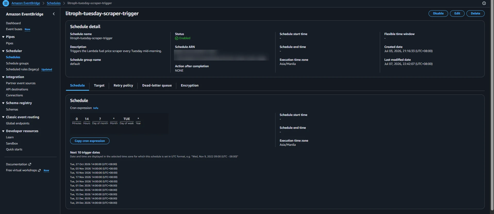 **EventBridge Scheduler:** Tuesday 14:00, Asia/Manila | 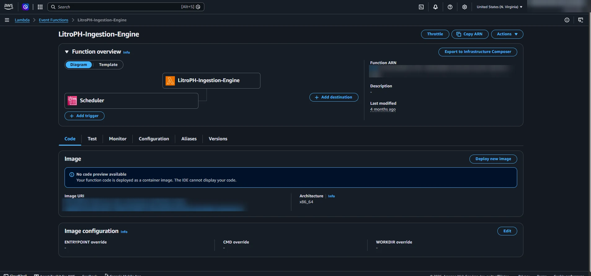 **Lambda:** container image from ECR, Scheduler trigger |
| 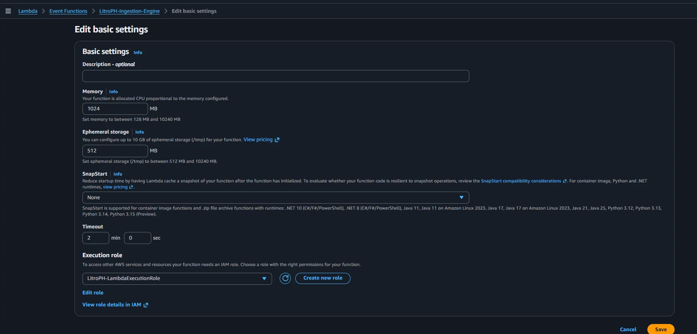 **Lambda configuration:** 1,024 MB, 2-minute timeout | 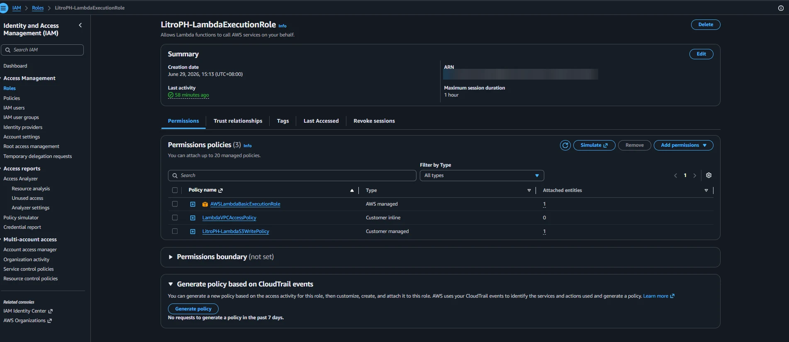 **IAM:** least-privilege execution role |
| 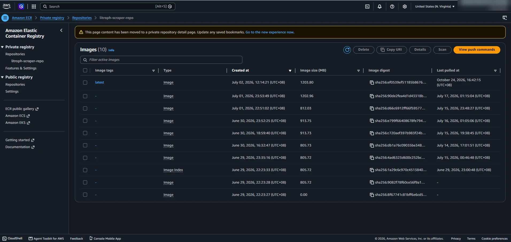 **ECR:** image versions | 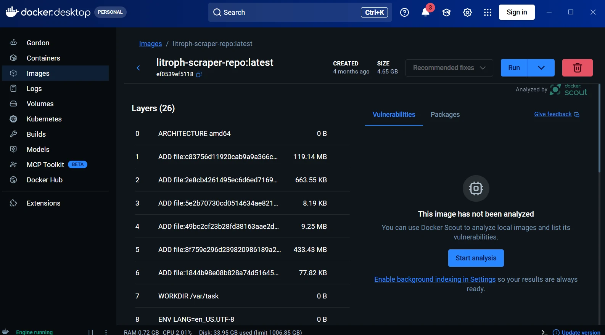 **Docker:** local image build |
| 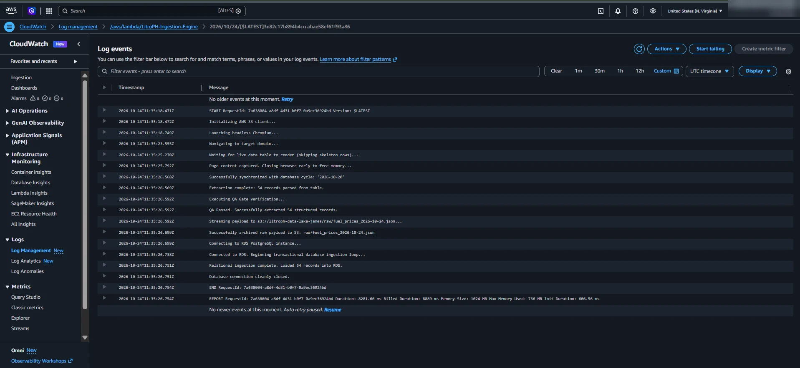 **CloudWatch:** one full run, 54 records in 8.3 s | 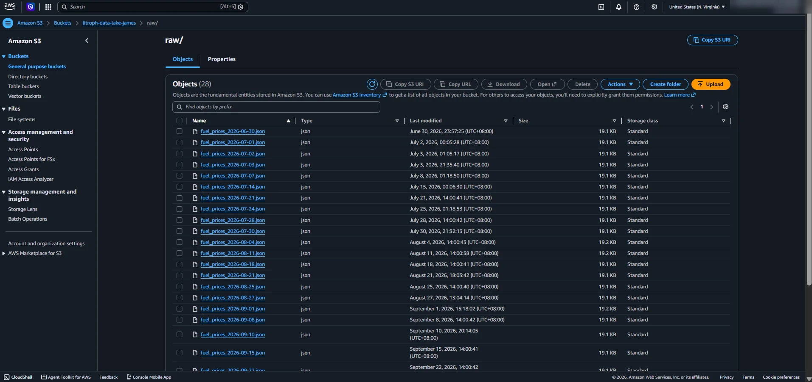 **S3:** raw JSON archive |
| 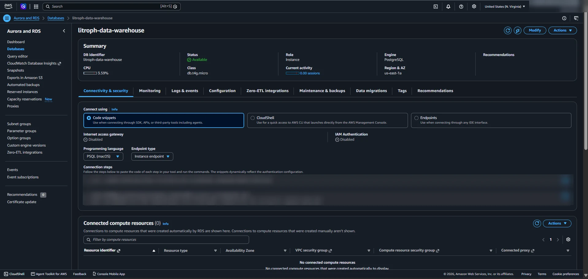 **RDS:** PostgreSQL warehouse | 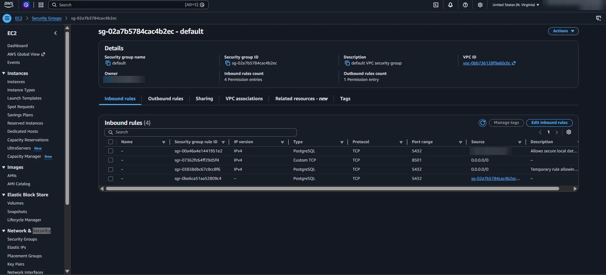 **Security group:** database inbound rules |
| 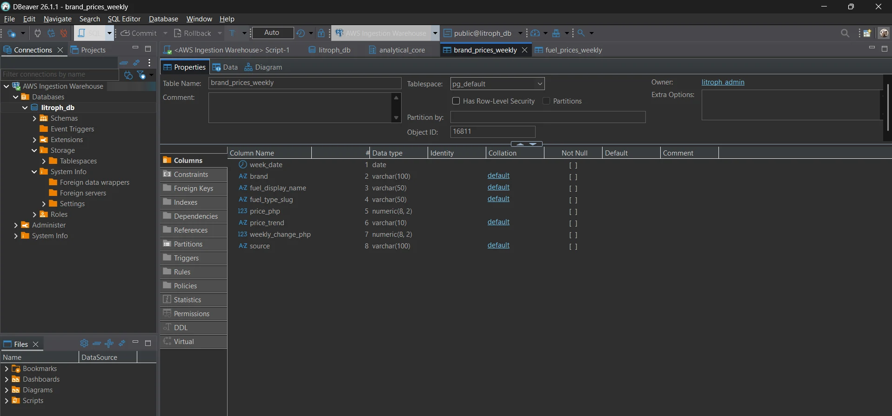 **Warehouse:** dbt mart in DBeaver | 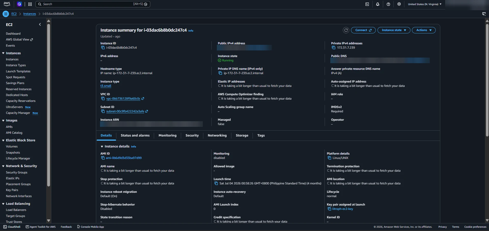 **EC2:** t3.small application server |
| 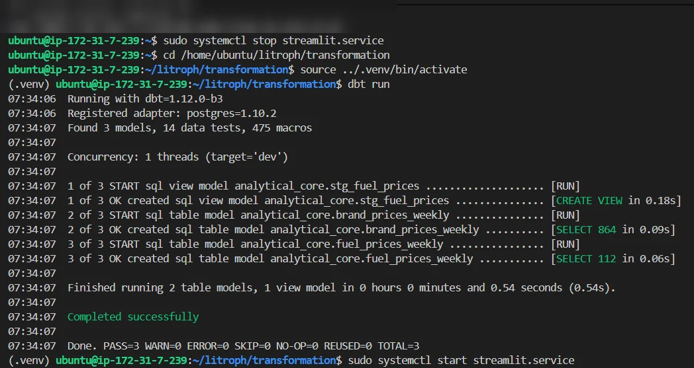 **dbt run on EC2:** 3 models | 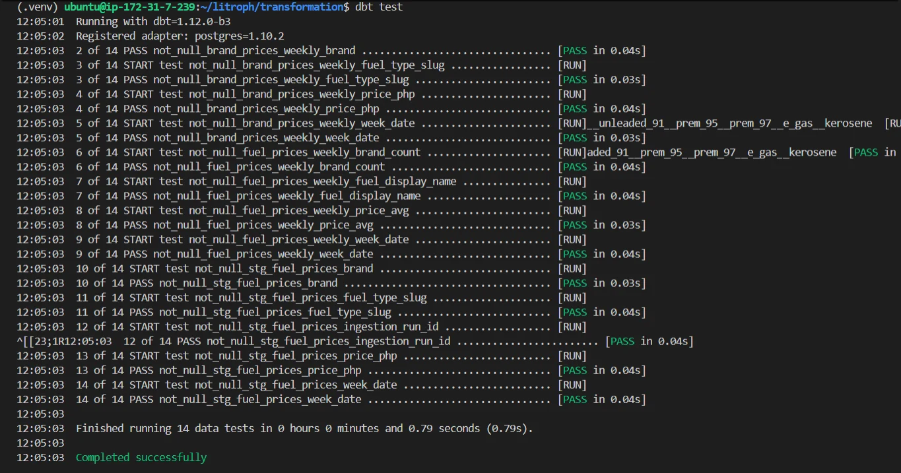 **dbt test:** 14 of 14 pass |
| 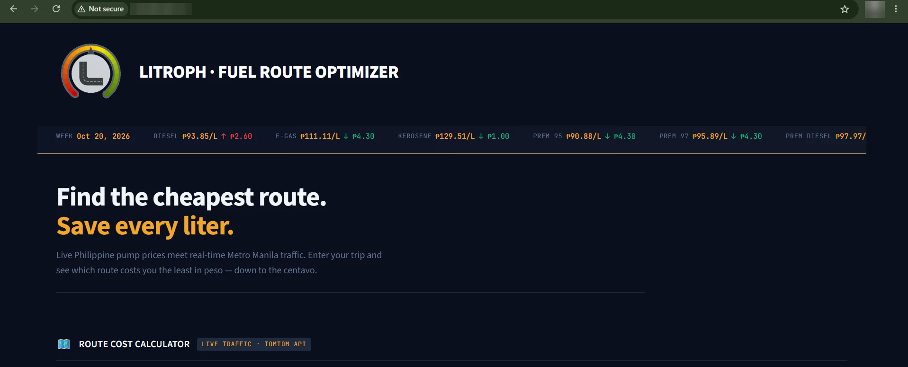 **Live dashboard** served from EC2 |  **Route cost calculator** |

---

## Engineering challenges

| Challenge | Decision |
|---|---|
| fuelprice.ph, the original data source, became unreliable for automated extraction | Switched to GasWatch PH, whose brand matrix has a stable structure |
| The price table is rendered with JavaScript; `requests` only returned skeleton rows | Headless browser with Playwright; wait for `tr:not(.skeleton-row)` before parsing |
| Async Playwright crashed inside Jupyter on Windows (`NotImplementedError`) | Synchronous Playwright on a worker thread in the notebooks |
| The OS firewall blocked Playwright's bundled Chromium on the development laptop | Automatic fallback to the installed Microsoft Edge (`channel="msedge"`) |
| Chromium exceeds Lambda's ZIP package limit | Container image in ECR |
| OSRM, the planned routing engine, has no live traffic | TomTom Routing API, whose free-flow and live times make the traffic multiplier possible |
| Retries could insert the same week twice | Brand dimension plus the `uq_price_per_week` constraint and conflict-ignoring batch inserts in one transaction |
| Folium maps broke on mobile and vanished on every Streamlit rerun | Render the map HTML with `components.html` and keep it in `st.session_state` |
| **The dashboard never refreshed on its own.** Three faults: the EC2 `run_pipeline.sh` was overwritten by an empty placeholder in the repo, the dbt cron ran before the scraper, and the dashboard's cached connection sat "idle in transaction", holding a lock that blocked `dbt run` | The real `run_pipeline.sh` is now in the repo, the cron runs after the scraper, the app connection uses autocommit, and the free-tier pipeline runs scrape → load → dbt in one job |

## Troubleshooting

| Symptom | Fix |
|---|---|
| `pip install` fails on Windows with `No such file or directory` deep inside `site-packages` | The path exceeded Windows' 260-character limit. Clone into a shorter folder (for example `C:\dev\litroph`) or [enable long paths](https://learn.microsoft.com/windows/win32/fileio/maximum-file-path-limitation#enable-long-paths-in-windows-10-version-1607-and-later) |
| `Activate.ps1 cannot be loaded because running scripts is disabled` | Run `Set-ExecutionPolicy RemoteSigned -Scope CurrentUser` once |
| `Env var required but not provided: 'DB_HOST'` from dbt | Load `.env` into the session first (step 6 of [Reproduce the project](#reproduce-the-project)) |
| Scraper fails to launch Chromium on Windows | It retries with Microsoft Edge automatically; make sure Edge is installed |
| `QA Gate Failed: No data extracted` | GasWatch PH changed its layout or was down; check the site and the selectors in `scraper.py` |
| `relation "raw_ingestion.dim_brands" does not exist` | Run `python scripts/init_db.py` |
| `dbt run` hangs | Something holds a lock on `analytical_core`. Check `SELECT pid, state, query FROM pg_stat_activity WHERE state = 'idle in transaction';` |
| `dbt test` fails `accepted_values` on `fuel_type_slug` | The site added a fuel type; review it and add the slug to `transformation/models/staging/schema.yml` |
| Map tiles don't load | Check `STADIA_API_KEY` and, for hosted apps, add the app's domain in the Stadia dashboard |
| "Could not fetch routes" | Check `TOMTOM_API_KEY` and its daily quota (2,500 free requests) |

## Scope, limitations and future work

**Limitations:** prices update weekly (Tuesday); routing is tuned for Metro Manila and geocoding is limited to the Philippines; fuel efficiency is entered manually; internal-combustion vehicles only; TomTom's free tier allows 2,500 requests per day.

**Future work:**
- Field-level QA in the scraper (quarantine prices outside ₱30–₱150 and weekly changes above ₱50, as prototyped in notebook 02)
- Failure alerts: workflow notifications, or a CloudWatch alarm with SNS on AWS
- A vehicle database with manufacturer fuel economy for popular models in the Philippines
- Electric vehicle support (km/kWh and charging prices)
- Price forecasting from the accumulated weekly history
- Coverage beyond Metro Manila

## References

- GasWatch PH: https://gaswatchph.com/
- Amazon Web Services documentation: https://docs.aws.amazon.com/
- PostgreSQL: https://www.postgresql.org/docs/
- dbt: https://docs.getdbt.com/
- Playwright for Python: https://playwright.dev/python/
- Beautiful Soup: https://www.crummy.com/software/BeautifulSoup/
- TomTom Developer Portal: https://developer.tomtom.com/
- Streamlit: https://docs.streamlit.io/
- Folium: https://python-visualization.github.io/folium/
- Plotly: https://plotly.com/python/
- Stadia Maps: https://docs.stadiamaps.com/
- Neon: https://neon.tech/docs
- GitHub Actions: https://docs.github.com/actions
- US EPA fuel economy: https://www.fueleconomy.gov/
- US Department of Energy, Alternative Fuels Data Center: https://afdc.energy.gov/

## Author

**James Andre L. Kalaw**
BS Data Science and Analytics, Technological Institute of the Philippines – Quezon City

This portfolio project demonstrates cloud data engineering on AWS, analytics engineering with dbt, data warehousing and interactive geospatial visualization.
